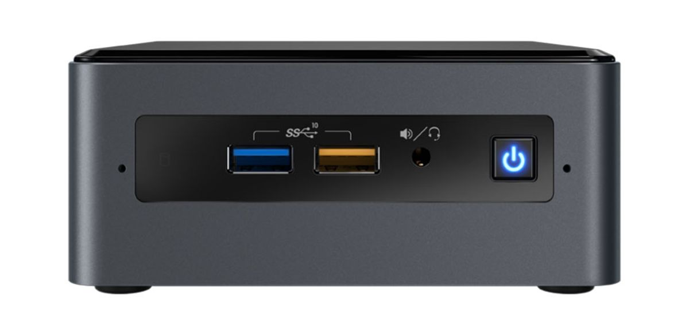

# NUC8 Hackintosh EFI — the most stable, most complete OpenCore EFI for the Intel NUC8 (Bean Canyon)



**The definitive EFI for the Intel NUC8.** Fully optimized, daily-driver stable, and running **every core feature** — graphics, 120 Hz display, onboard audio, HDMI/DisplayPort audio, Ethernet, Wi-Fi, Bluetooth, USB, NVMe and sleep. This is not a "boots and mostly works" config: it is a daily-driver EFI validated across repeated cold boots, with the panics it still produces traced as far as the logs allow. Anything still open is documented in [Known issues](#known-issues) rather than swept under the rug.

> **macOS Sequoia 15.7.2 (24G325) · OpenCore 1.0.7 · SMBIOS Macmini8,1**

---

## Why this EFI?

- ⚠️ **Fixes the common NUC8 boot panic — but not every variant.** Eliminates the AppleHDA `DspFuncLib` use-after-free / AppleALC page-fault panic caused by `no-controller-inject`, *without* sacrificing HDMI/DP audio. A rarer AppleHDA HDMI/DP teardown panic can still fire while `coreaudiod` enumerates devices at boot. See [Known issues](#known-issues).
- ✅ **Both audio paths work at the same time:** onboard Realtek ALC235 (3.5 mm jack) **and** HDMI/DisplayPort monitor audio, selectable and hot-switchable.
- ✅ **Full graphics acceleration** — Intel Iris Plus Graphics 655, QE/CI, Metal, 1536 MB VRAM, **2560×1440 @ 120 Hz**.
- ✅ **Native-feeling networking** — Intel Ethernet + Intel Wi-Fi (AirportItlwm) + Bluetooth.
- ✅ **Clean, minimal, documented config** — every patch has a reason. No mystery kexts, no "shotgun" fixes.
- ✅ **Validated over 4/4 consecutive cold boots** with HDMI audio enumerating every time (see [Validation](#validation)) — a sample, not a guarantee.

---

## Hardware

| Component | Model |
|---|---|
| Machine | Intel NUC8 (Bean Canyon) |
| CPU | Intel Core i3-8109U (2C/4T, 3.0–3.6 GHz) |
| iGPU | Intel Iris Plus Graphics 655 (`0x3EA5`) |
| Audio | Realtek ALC235 (`pci8086,9dc8`) |
| Ethernet | Intel I219-V |
| Wi-Fi / BT | Intel Wireless-AC |

> Also expected to work on i5-8259U / i7-8559U Bean Canyon NUCs (same platform/GPU), though this exact EFI was tuned and validated on the i3-8109U.

---

## What works

| Feature | Status | Notes |
|---|---|---|
| Graphics acceleration (QE/CI, Metal) | ✅ | Iris Plus 655, 1536 MB |
| 2560×1440 @ 120 Hz | ✅ | DisplayPort |
| Onboard audio (3.5 mm jack) | ✅ | AppleALC, layout-id 8 |
| HDMI / DisplayPort audio | ✅ | `hda-gfx=onboard-1` on IGPU + HDEF |
| Ethernet | ✅ | IntelMausi |
| Wi-Fi | ✅ | AirportItlwm 2.4.0 |
| Bluetooth | ✅ | IntelBluetoothFirmware + BlueToolFixup + IntelBTPatcher |
| USB (all ports, mapped) | ✅ | USBToolBox + UTBMap |
| NVMe | ✅ | NVMeFix; boot-time TRIM disabled (`SetApfsTrimTimeout = 0`) |
| Sleep / wake | ✅ | |
| App Store / iCloud / iMessage | ⚠️ | **Requires your own SMBIOS** — see below |
| AirDrop / Continuity | ⚠️ | Depends on Wi-Fi card; Intel cards are limited |

---

## The panic fix

Earlier NUC8 EFIs suffered a boot panic in `AppleHDA` / `DspFuncLib` (use-after-free) or a page fault in `AppleALC`:

```
panic: AppleHDA ... DspFuncLib ... use-after-free
panic: AppleALC ... CR2: 0x10 ... AlcEnabler::init()
```

**Root cause:** `no-controller-inject` was present on the iGPU device properties. That makes AppleALC's `validateInjection()` fail, so it never sets `hda-gfx` on the iGPU and never registers the HDMI/DP controller. `AppleHDAHDMI_DPDriver::initHardware` then cannot link to the framebuffer, and its teardown frees shared `DspFuncLib` objects out from under the live driver → use-after-free panic.

**The fix (applied in this EFI):**

1. **Remove** `no-controller-inject` from `PciRoot(0x0)/Pci(0x2,0x0)` (IGPU).
2. **Add** `hda-gfx = onboard-1` to the IGPU.
3. **Add** `hda-gfx = onboard-1` to `PciRoot(0x0)/Pci(0x1F,0x3)` (HDEF).

That's it. HDMI/DP audio initializes correctly and the `no-controller-inject` panic class is gone — **no `No-hda-gfx` workaround, no disabled audio.** A separate, much rarer teardown panic can still occur at boot; see [Known issues](#known-issues).

<details>
<summary>Fallback if you ever need it</summary>

If you hit the remaining boot panic and don't need monitor audio, set `No-hda-gfx` on HDEF and remove `hda-gfx` from both devices. This guarantees stability at the cost of HDMI/DP audio. Upstream's only fix for the HDMI/DP variant is the same trade-off.
</details>

---

## Kexts

| Kext | Version | Purpose |
|---|---|---|
| Lilu | 1.7.2 | Patching framework |
| VirtualSMC | 1.3.8 | SMC emulation |
| SMCProcessor | 1.3.8 | CPU sensors |
| SMCSuperIO | 1.3.8 | Fan/IO sensors |
| AppleALC | 1.9.8 | Audio (ALC235 + HDMI/DP) |
| WhateverGreen | 1.7.1 | Graphics / framebuffer |
| AirportItlwm | 2.4.0 | Intel Wi-Fi |
| IntelBluetoothFirmware | 2.5.0 | Intel Bluetooth |
| IntelBTPatcher | 2.5.0 | Bluetooth patches |
| BlueToolFixup | 2.7.2 | Bluetooth (Monterey+) |
| IntelMausiEthernet | 3.0.3 | Intel Ethernet |
| NVMeFix | 1.1.4 | NVMe power/TRIM |
| RestrictEvents | 1.1.7 | CPU naming / updates |
| Sinetek-rtsx | 9.0.0 | *Disabled* — loads but never matches the reader |
| USBToolBox | 1.2.0 | USB mapping base |
| UTBMap | 1.1 | USB port map |
| XHCI-unsupported | 0.9.2 | XHCI compatibility |
| AMFIPass | 1.4.1 | *Disabled* (included for reference) |

**Drivers:** OpenRuntime, OpenCanopy, OpenHfsPlus, OpenPartitionDxe, OpenLinuxBoot, Ext4Dxe, AudioDxe, ResetNvramEntry.

**Boot args:** `igfxonln=1`

---

## Installation

1. **Back up your existing EFI.**
2. Mount your ESP and copy the `EFI` folder from this repo to it (replace your current `EFI`).
3. **Generate your own SMBIOS** (this repo ships with placeholder values):
   - Use [GenSMBIOS](https://github.com/corpnewt/GenSMBIOS) with model **`Macmini8,1`**.
   - In `config.plist` → `PlatformInfo → Generic`, replace:
     - `SystemSerialNumber`
     - `MLB`
     - `SystemUUID`
     - `ROM`
   - Do **not** share your real serials publicly.
4. Set your BIOS:
   - Secure Boot **off**, Fast Boot **off**, VT-d **off** (or keep on with `disableio` — this EFI expects off), CFG-Lock **off** if possible.
   - UEFI boot, SATA mode **AHCI**.
5. Boot from the USB/ESP. The OpenCore picker only appears if you hold **Alt / Esc / 0** — otherwise it boots straight through.
6. Install macOS, then copy the EFI to the internal ESP and set it as the boot entry.

> **Note:** The OpenCore picker is intentionally hidden (`Timeout = 0`, `ShowPicker = false`) for a clean, Mac-like boot. Hold a key at boot to reveal it.

---

## Validation

This EFI was tested across **4 consecutive cold boots**:

| Boot | Kernel panics | `hda-gfx` IGPU/HDEF | HDMI/DP driver | DP audio engine | Default output |
|---|---|---|---|---|---|
| 1 | 0 new | ✅ / ✅ | active | present | DisplayPort |
| 2 | 0 new | ✅ / ✅ | active | present | DisplayPort |
| 3 | 0 new | ✅ / ✅ | active | present | DisplayPort |
| 4 | 0 new | ✅ / ✅ | active | present | DisplayPort |

Both the analog (jack) and DisplayPort audio engines were confirmed streaming (`IOAudioEngineState = 1`) with real playback.

---

## Known issues

This section exists so the claims above stay honest. A few things were observed on the donor machine and are documented rather than hidden:

**1. Intermittent early-boot `kalloc` panic — the one real open issue**

This EFI is not 100 % panic-free. Ten panic reports were collected on the donor machine over a week of daily use, and all of them belong to the same `kalloc … element modified after free` family:

| Where it surfaces | Uptime | Count |
|---|---|---|
| `AppleHDA` / `DspFuncLib` | 9.6–12.3 s | 8 |
| `apfs` | 1.35 s | 1 |
| `logd` | 4.6 s | 1 |

- The AppleHDA ones fire while `coreaudiod` enumerates the audio devices at boot. That is a known upstream AppleALC/AppleHDA HDMI/DP bug ([bugtracker #1551](https://github.com/acidanthera/bugtracker/issues/1551), [#1283](https://github.com/acidanthera/bugtracker/issues/1283)).
- It can fire twice in a row (01:18 and 01:20 on the same night), so a machine may need two or three boot attempts.
- It only shows up on the **first boot after the machine has been powered off for hours**; warm reboots have been clean.
- The `apfs` and `logd` variants have no audio kext in the backtrace — most likely the same stale write landing in whichever 16-byte allocation is used next.

The filesystem is not the cause: `diskutil verifyVolume disk1` and `diskutil verifyVolume disk1s1` both return **exit 0**, NVMe SMART is **Verified**, and there are no APFS mount errors in the logs.

**If you need absolute stability**, set `No-hda-gfx` on HDEF and remove `hda-gfx` from both devices. That is upstream's only fix for the HDMI/DP variant, and it costs you monitor audio — the 3.5 mm jack keeps working. This EFI deliberately keeps both audio paths and accepts the occasional boot panic.

If you see this signature repeatedly, run a memory test before blaming the config: sporadic early-boot zone corruption is a classic symptom of marginal RAM.

**2. Boot-time TRIM is intentionally disabled**

`Kernel → Quirks → SetApfsTrimTimeout` is set to **`0`**, which on macOS 12+ **disables TRIM at boot**. This is deliberate: it avoids the long boot-time TRIM stall that cheap DRAM-less NVMe drives exhibit. macOS still reports "TRIM Support: Yes" in System Information, but boot-time trimming is off. If you have a good NVMe drive and want trimming back, set it to `-1`.

**3. Long shutdowns on some systems**

Every shutdown on the donor machine writes a `shutdown_stall` report. Decoding it shows **`CloudTelemetryService`** (`privatecloudcomputed`) hanging, which is a macOS/iCloud telemetry behaviour and is unrelated to this EFI.

---

## Troubleshooting

- **No HDMI/DP audio:** confirm `hda-gfx=onboard-1` exists on both IGPU and HDEF, and that `no-controller-inject` is **absent** from IGPU.
- **Boot panic in AppleHDA/AppleALC:** make sure `no-controller-inject` is **absent** from IGPU (that is the fix above). If you still hit it and don't use monitor audio, add `No-hda-gfx` to HDEF — see [Known issues](#known-issues).
- **iServices not working:** generate your own SMBIOS; the placeholders here are intentionally fake.
- **Wi-Fi not connecting:** ensure AirportItlwm matches your macOS version (2.4.0 = Sequoia).
- **Picker not showing:** hold Alt/Esc/0 during boot.

---

## Credits

- [Acidanthera](https://github.com/acidanthera) — OpenCore, Lilu, WhateverGreen, AppleALC, VirtualSMC, AirportItlwm, NVMeFix, RestrictEvents and more.
- [Olarila](https://www.olarila.com/) — community and logo.
- [zearp/Nucintosh](https://github.com/zearp/Nucintosh) — NUC8 reference work.
- Everyone who reported and diagnosed the AppleALC/AppleHDA panic.

<p align="center">
  
</p>

---

## Disclaimer

This EFI is provided **as-is**, for the Intel NUC8 platform. Hackintosh is not supported by Apple. You are responsible for your own hardware, data and Apple ID. Always keep a backup of your working EFI and never publish your real SMBIOS serials.
